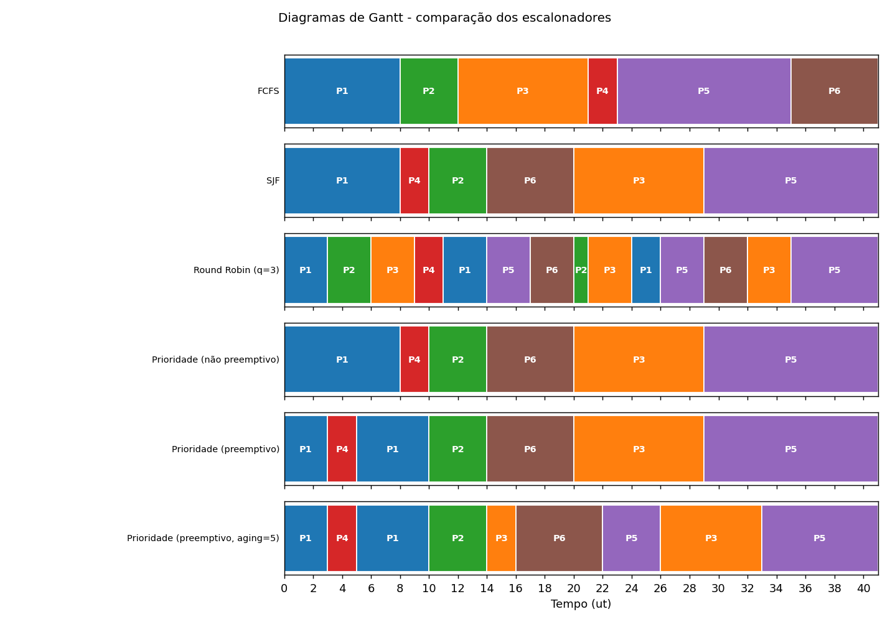
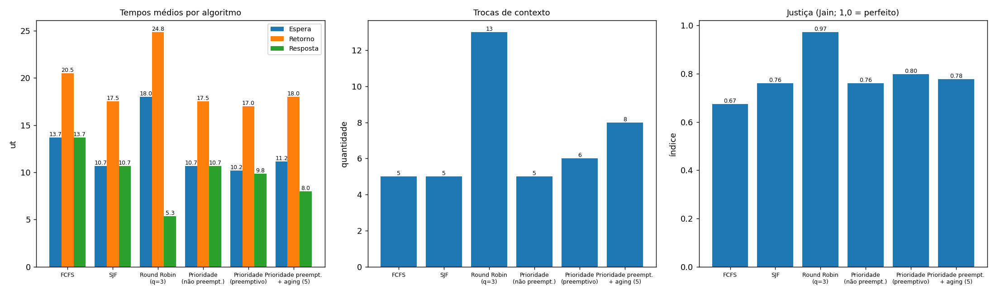
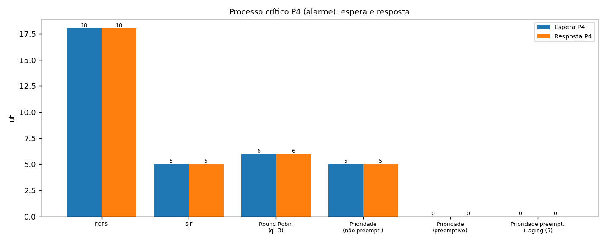
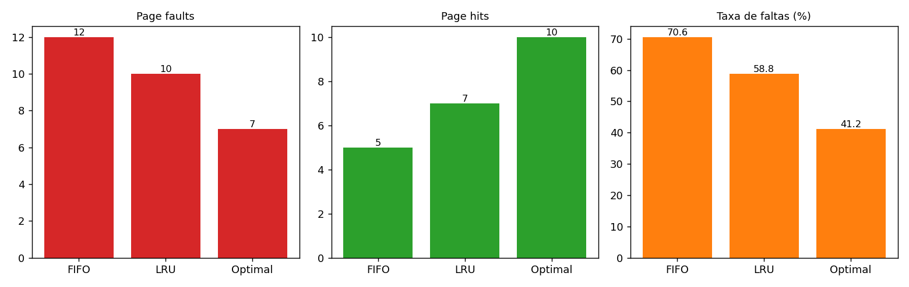
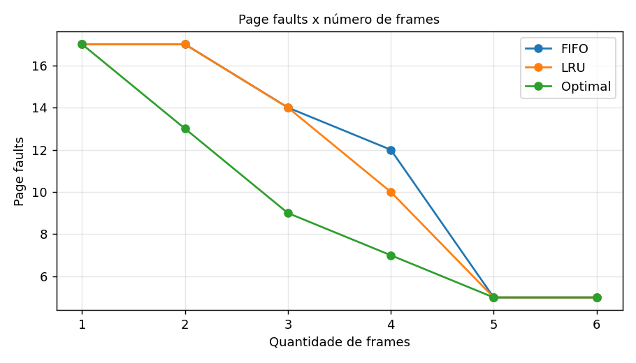

# KernelLab - Resultados da simulação

## Entrada

| Proc | Função | Chegada | Burst | Prioridade | Memória | Dispositivos |
|---|---|---|---|---|---|---|
| P1 | Monitoramento cardíaco | 0 | 8 | 1 | 120 MB | rede |
| P2 | Transmissão de telemetria | 1 | 4 | 2 | 80 MB | rede |
| P3 | Geração de relatórios | 2 | 9 | 4 | 200 MB | disco |
| P4 | Emissão de alarme crítico | 3 | 2 | 0 | 60 MB | audio, rede |
| P5 | Backup do sistema | 5 | 12 | 5 | 300 MB | disco |
| P6 | Atualização de dados | 6 | 6 | 3 | 150 MB | disco, rede |

Quantum do Round Robin: 3

## Etapa 1 - Escalonamento da CPU

### FCFS

Ordem de execução (1ª vez na CPU): P1 -> P2 -> P3 -> P4 -> P5 -> P6

Diagrama de Gantt:
```
|           P1          |     P2    |            P3            |  P4 |                 P5                |        P6       |
0                       8           12                         21    23                                  35                41
```

```
Proc  Cheg Burst Prio Início  Fim  Espera  Retorno  Resposta
------------------------------------------------------------
P1       0     8    1      0    8       0        8         0
P2       1     4    2      8   12       7       11         7
P3       2     9    4     12   21      10       19        10
P4       3     2    0     21   23      18       20        18
P5       5    12    5     23   35      18       30        18
P6       6     6    3     35   41      29       35        29
------------------------------------------------------------
MÉDIA                               13.67    20.50     13.67
```

Trocas de contexto: 5
Atraso excessivo / risco de starvation: P6 (espera 29 ut, penalidade 4.83x); P4 (espera 18 ut, penalidade 9.0x); P5 (espera 18 ut, penalidade 1.5x)

### SJF

Ordem de execução (1ª vez na CPU): P1 -> P4 -> P2 -> P6 -> P3 -> P5

Diagrama de Gantt:
```
|           P1          |  P4 |     P2    |        P6       |            P3            |                 P5                |
0                       8     10          14                20                         29                                  41
```

```
Proc  Cheg Burst Prio Início  Fim  Espera  Retorno  Resposta
------------------------------------------------------------
P1       0     8    1      0    8       0        8         0
P2       1     4    2     10   14       9       13         9
P3       2     9    4     20   29      18       27        18
P4       3     2    0      8   10       5        7         5
P5       5    12    5     29   41      24       36        24
P6       6     6    3     14   20       8       14         8
------------------------------------------------------------
MÉDIA                               10.67    17.50     10.67
```

Trocas de contexto: 5
Atraso excessivo / risco de starvation: P5 (espera 24 ut, penalidade 2.0x); P3 (espera 18 ut, penalidade 2.0x); P2 (espera 9 ut, penalidade 2.25x); P4 (espera 5 ut, penalidade 2.5x)

### Round Robin (q=3)

Ordem de execução (1ª vez na CPU): P1 -> P2 -> P3 -> P4 -> P5 -> P6

Diagrama de Gantt:
```
|   P1   |   P2   |   P3   |  P4 |   P1   |   P5   |   P6   |P2|   P3   |  P1 |   P5   |   P6   |   P3   |        P5       |
0        3        6        9     11       14       17       20 21       24    26       29       32       35                41
```

```
Proc  Cheg Burst Prio Início  Fim  Espera  Retorno  Resposta
------------------------------------------------------------
P1       0     8    1      0   26      18       26         0
P2       1     4    2      3   21      16       20         2
P3       2     9    4      6   35      24       33         4
P4       3     2    0      9   11       6        8         6
P5       5    12    5     14   41      24       36         9
P6       6     6    3     17   32      20       26        11
------------------------------------------------------------
MÉDIA                               18.00    24.83      5.33
```

Trocas de contexto: 13
Atraso excessivo / risco de starvation: P3 (espera 24 ut, penalidade 2.67x); P5 (espera 24 ut, penalidade 2.0x); P6 (espera 20 ut, penalidade 3.33x); P1 (espera 18 ut, penalidade 2.25x); P2 (espera 16 ut, penalidade 4.0x); P4 (espera 6 ut, penalidade 3.0x)

### Prioridade (não preemptivo)

Ordem de execução (1ª vez na CPU): P1 -> P4 -> P2 -> P6 -> P3 -> P5

Diagrama de Gantt:
```
|           P1          |  P4 |     P2    |        P6       |            P3            |                 P5                |
0                       8     10          14                20                         29                                  41
```

```
Proc  Cheg Burst Prio Início  Fim  Espera  Retorno  Resposta
------------------------------------------------------------
P1       0     8    1      0    8       0        8         0
P2       1     4    2     10   14       9       13         9
P3       2     9    4     20   29      18       27        18
P4       3     2    0      8   10       5        7         5
P5       5    12    5     29   41      24       36        24
P6       6     6    3     14   20       8       14         8
------------------------------------------------------------
MÉDIA                               10.67    17.50     10.67
```

Trocas de contexto: 5
Atraso excessivo / risco de starvation: P5 (espera 24 ut, penalidade 2.0x); P3 (espera 18 ut, penalidade 2.0x); P2 (espera 9 ut, penalidade 2.25x); P4 (espera 5 ut, penalidade 2.5x)

### Prioridade (preemptivo)

Ordem de execução (1ª vez na CPU): P1 -> P4 -> P2 -> P6 -> P3 -> P5

Diagrama de Gantt:
```
|   P1   |  P4 |      P1      |     P2    |        P6       |            P3            |                 P5                |
0        3     5              10          14                20                         29                                  41
```

```
Proc  Cheg Burst Prio Início  Fim  Espera  Retorno  Resposta
------------------------------------------------------------
P1       0     8    1      0   10       2       10         0
P2       1     4    2     10   14       9       13         9
P3       2     9    4     20   29      18       27        18
P4       3     2    0      3    5       0        2         0
P5       5    12    5     29   41      24       36        24
P6       6     6    3     14   20       8       14         8
------------------------------------------------------------
MÉDIA                               10.17    17.00      9.83
```

Trocas de contexto: 6
Atraso excessivo / risco de starvation: P5 (espera 24 ut, penalidade 2.0x); P3 (espera 18 ut, penalidade 2.0x); P2 (espera 9 ut, penalidade 2.25x)

### Prioridade (preemptivo, aging=5)

Ordem de execução (1ª vez na CPU): P1 -> P4 -> P2 -> P3 -> P6 -> P5

Diagrama de Gantt:
```
|   P1   |  P4 |      P1      |     P2    |  P3 |        P6       |     P5    |         P3         |           P5          |
0        3     5              10          14    16                22          26                   33                      41
```

```
Proc  Cheg Burst Prio Início  Fim  Espera  Retorno  Resposta
------------------------------------------------------------
P1       0     8    1      0   10       2       10         0
P2       1     4    2     10   14       9       13         9
P3       2     9    4     14   33      22       31        12
P4       3     2    0      3    5       0        2         0
P5       5    12    5     22   41      24       36        17
P6       6     6    3     16   22      10       16        10
------------------------------------------------------------
MÉDIA                               11.17    18.00      8.00
```

Trocas de contexto: 8
Atraso excessivo / risco de starvation: P5 (espera 24 ut, penalidade 2.0x); P3 (espera 22 ut, penalidade 2.44x); P2 (espera 9 ut, penalidade 2.25x)

## Etapa 2 - Comparação dos escalonadores

```
Algoritmo                                 Espera  Retorno  Resp. Trocas P4 esp. P4 resp.   Jain
-----------------------------------------------------------------------------------------------
FCFS                                       13.67    20.50  13.67      5      18       18  0.674
SJF                                        10.67    17.50  10.67      5       5        5  0.761
Round Robin (q=3)                          18.00    24.83   5.33     13       6        6  0.972
Prioridade (não preemptivo)                10.67    17.50  10.67      5       5        5  0.761
Prioridade (preemptivo)                    10.17    17.00   9.83      6       0        0  0.799
Prioridade (preemptivo, aging=5)           11.17    18.00   8.00      8       0        0  0.777
```

Respostas calculadas automaticamente:

- Menor tempo médio de espera (4 obrigatórios): SJF (10.67 ut); considerando também as variantes: Prioridade (preemptivo) (10.17 ut).
- Melhor tempo médio de resposta: Round Robin (q=3) (5.33 ut).
- Melhor tratamento do alarme (P4): Prioridade (preemptivo) (resposta 0 ut, espera 0 ut).
- Distribuição mais justa (Jain): Round Robin (q=3) (0.972).
- Mais trocas de contexto: Round Robin (q=3) (13).
- Maior risco de starvation: escalonamento por prioridade (e SJF) sem aging - processos longos/de baixa prioridade (P5, P3) podem ser adiados indefinidamente se continuarem chegando processos mais prioritários/curtos; com aging o atraso diminui.

### Cenário de estresse: starvation com chegadas contínuas

BKP (prioridade 5, burst 4) chega em t=1; a cada 3 ut chega um processo de prioridade 1 (burst 3), mantendo a CPU saturada.

- Prioridade preemptiva SEM aging: BKP espera 23 ut (conclui em t=28).
- Prioridade preemptiva COM aging (3 ut): BKP espera 12 ut (conclui em t=17).

## Etapa 3 - Gerenciamento de memória

Frames: 4 | Referências (17): 1, 2, 3, 4, 1, 2, 5, 1, 2, 3, 4, 5, 2, 1, 5, 3, 2

### FIFO

```
  # Ref  F1  F2  F3  F4   Resultado
-------------------------------------------------
  1   1  1   -   -   -    FAULT
  2   2  1   2   -   -    FAULT
  3   3  1   2   3   -    FAULT
  4   4  1   2   3   4    FAULT
  5   1  1   2   3   4    HIT
  6   2  1   2   3   4    HIT
  7   5  5   2   3   4    FAULT (sai 1)
  8   1  5   1   3   4    FAULT (sai 2)
  9   2  5   1   2   4    FAULT (sai 3)
 10   3  5   1   2   3    FAULT (sai 4)
 11   4  4   1   2   3    FAULT (sai 5)
 12   5  4   5   2   3    FAULT (sai 1)
 13   2  4   5   2   3    HIT
 14   1  4   5   1   3    FAULT (sai 2)
 15   5  4   5   1   3    HIT
 16   3  4   5   1   3    HIT
 17   2  4   5   1   2    FAULT (sai 3)
Hits=5  Faults=12  Taxa de faltas=70.6%
```

### LRU

```
  # Ref  F1  F2  F3  F4   Resultado
-------------------------------------------------
  1   1  1   -   -   -    FAULT
  2   2  1   2   -   -    FAULT
  3   3  1   2   3   -    FAULT
  4   4  1   2   3   4    FAULT
  5   1  1   2   3   4    HIT
  6   2  1   2   3   4    HIT
  7   5  1   2   5   4    FAULT (sai 3)
  8   1  1   2   5   4    HIT
  9   2  1   2   5   4    HIT
 10   3  1   2   5   3    FAULT (sai 4)
 11   4  1   2   4   3    FAULT (sai 5)
 12   5  5   2   4   3    FAULT (sai 1)
 13   2  5   2   4   3    HIT
 14   1  5   2   4   1    FAULT (sai 3)
 15   5  5   2   4   1    HIT
 16   3  5   2   3   1    FAULT (sai 4)
 17   2  5   2   3   1    HIT
Hits=7  Faults=10  Taxa de faltas=58.8%
```

### Optimal

```
  # Ref  F1  F2  F3  F4   Resultado
-------------------------------------------------
  1   1  1   -   -   -    FAULT
  2   2  1   2   -   -    FAULT
  3   3  1   2   3   -    FAULT
  4   4  1   2   3   4    FAULT
  5   1  1   2   3   4    HIT
  6   2  1   2   3   4    HIT
  7   5  1   2   3   5    FAULT (sai 4)
  8   1  1   2   3   5    HIT
  9   2  1   2   3   5    HIT
 10   3  1   2   3   5    HIT
 11   4  1   2   4   5    FAULT (sai 3)
 12   5  1   2   4   5    HIT
 13   2  1   2   4   5    HIT
 14   1  1   2   4   5    HIT
 15   5  1   2   4   5    HIT
 16   3  3   2   4   5    FAULT (sai 1)
 17   2  3   2   4   5    HIT
Hits=10  Faults=7  Taxa de faltas=41.2%
```

### Comparação

| Algoritmo | Page hits | Page faults | Taxa de faltas |
|---|---|---|---|
| FIFO | 5 | 12 | 70.6% |
| LRU | 7 | 10 | 58.8% |
| Optimal | 10 | 7 | 41.2% |

Melhor resultado: **Optimal** (7 faltas) - referência teórica.
Melhor algoritmo implementável: **LRU** (10 faltas).

Justificativa: o Optimal (7 faltas) enxerga o futuro e descarta a página cujo próximo uso é o mais distante - é um limite inferior, impossível de implementar na prática. O LRU (10) aproxima o Optimal usando o passado recente como previsão (localidade temporal). O FIFO (12) ignora o uso e pode descartar páginas muito acessadas só por serem antigas.

## Etapa 4 - Controle de dispositivos

### Matriz de controle de acesso

```
Processo     disco        rede       audio        log     
----------------------------------------------------------
P1             -          RWU          -           W      
P2             -          RWU          -           W      
P3            RWU          -           -           W      
P4             -          WXUE        WXUE         W      
P5           RWXUE         -           -           W      
P6            RWU         RWU          -           W      
Legenda: R=ler  W=gravar  X=executar  U=utilizar  E=acesso exclusivo  -=sem acesso
```

### Verificação de acessos

- P1 -> disco (W): NEGADO - P1 NÃO tem permissão 'W' (gravar) em 'disco'.
- P3 -> rede (U): NEGADO - P3 NÃO tem permissão 'U' (utilizar) em 'rede'.
- P2 -> audio (U): NEGADO - P2 NÃO tem permissão 'U' (utilizar) em 'audio'.
- P4 -> audio (E): PERMITIDO

### Fila de solicitações concorrentes ao disco (tempo simulado)

P3, P5, P6 e P1 pedem o disco quase juntos; P1 não tem permissão e é recusado.

```
Fila do dispositivo 'disco' (mutex, FIFO)
Proc   Chegada  Início   Fim  Espera
------------------------------------
P3           2       2     6       0
P5           3       6    11       3
P6           4      11    14       7
```

- Recusado: P1 NÃO tem permissão 'W' (gravar) em 'disco'.

### Exclusão mútua com threads reais

- SEM mutex: contador final = 205 (esperado 1000) -> condição de corrida (atualizações perdidas).
- COM mutex: contador final = 1000 (esperado 1000) -> correto.

Uso do disco por 3 threads (mutex, capacidade 1) - intervalos em ms:
```
P3  [     0 ->     50]
P5  [    50 ->    101]
P6  [   101 ->    151]
```
Sobreposições detectadas: 0 (esperado: 0).

## Recomendação final

**Política recomendada: escalonamento por prioridade PREEMPTIVO, com aging como proteção contra starvation**
(e Round Robin apenas entre processos de mesma prioridade, se houver).

- **Criticidade:** o alarme (P4) recebe a CPU assim que chega (resposta 0 ut). FCFS o faz
  esperar 18 ut e o Round Robin 6 ut - inaceitável para um alarme clínico.
- **Desempenho:** espera média de 10,17 ut, a menor entre todas as políticas testadas (FCFS 13,67; RR 18,00).
- **Justiça / starvation:** o RR é o mais justo (Jain 0,97), mas atrasa o alarme em 6 ut.
  O aging tem custo no cenário base (espera média 10,17 -> 11,17 ut; trocas de contexto 6 -> 8),
  mas no cenário de estresse reduz a espera do processo de baixa prioridade de 23 para 12 ut,
  evitando starvation real. Com `aging_floor=1`, a classe 0 fica reservada ao alarme (P4 continua com espera 0). O intervalo deve ser calibrado.
- **Memória:** LRU (ou uma aproximação barata, como o algoritmo do relógio), pois reduz as faltas em relação ao FIFO.
- **Dispositivos:** manter a matriz de menor privilégio e mutex/semáforo; acesso exclusivo restrito a P4 (áudio/rede) e P5 (disco).

**Limitações que permanecem:** 1 CPU e burst conhecido de antemão (SJF/prioridade dependem disso); sem custo de troca de
contexto nem E/S bloqueante; sem tratamento de inversão de prioridade (um processo de baixa prioridade segurando o mutex que
o alarme precisa exigiria *priority inheritance*); sequência de páginas fixa e curta; sem garantias de tempo real rígido
(deadlines, EDF/RMS).

## Etapa 5 - Gráficos gerados






